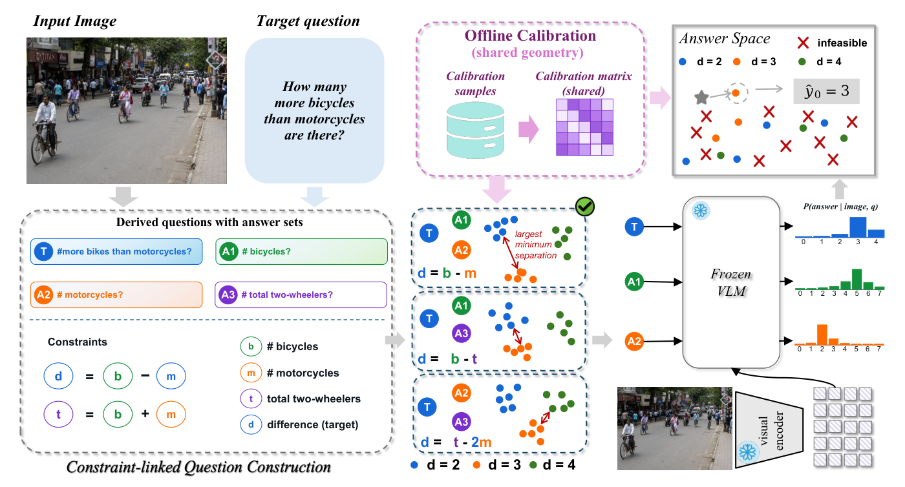
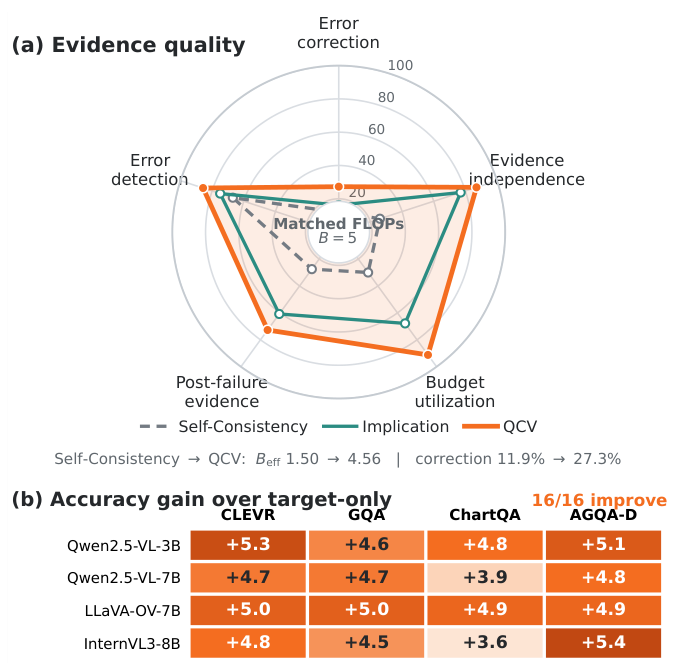
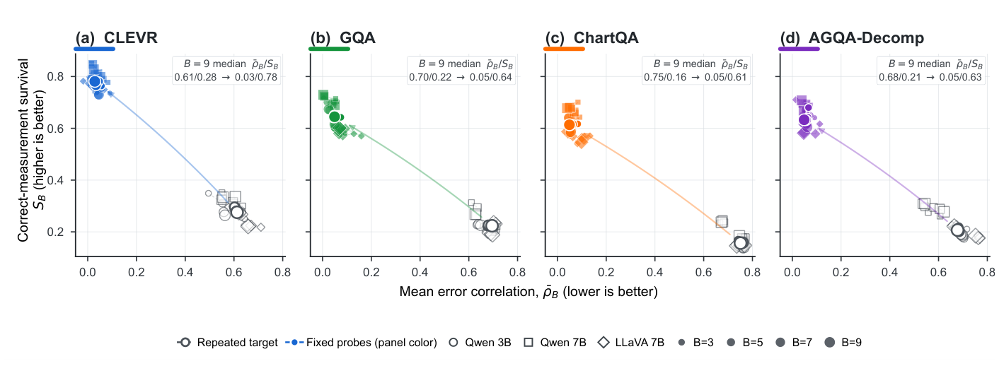
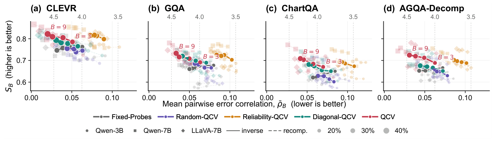
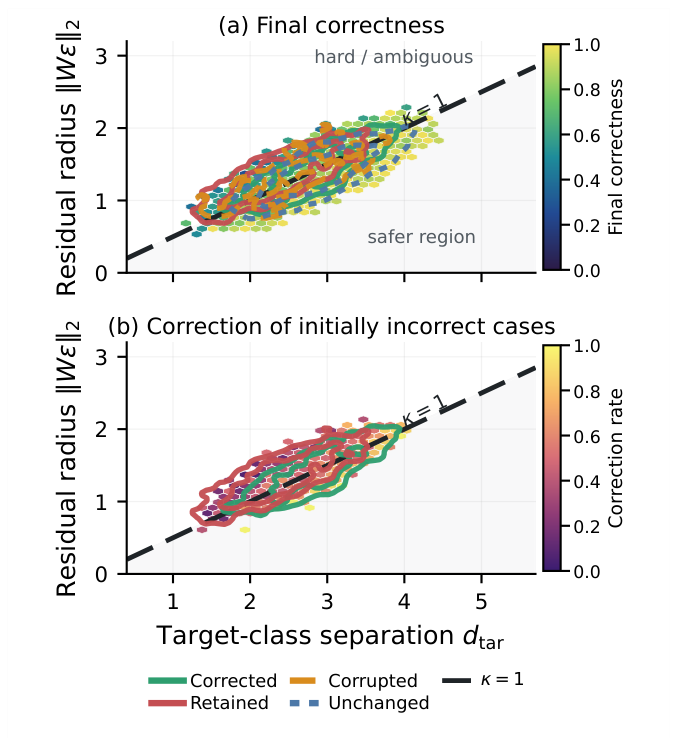

# Questions as Codes: Correcting Multimodal Reasoning at Test Time

Official implementation of **Question-Code Verification (QCV)**: a test-time procedure that spends a fixed budget of question evaluations on relation-linked auxiliary questions and corrects the answer of a frozen vision-language model by projecting calibrated answer distributions onto a code of jointly valid answers.


[](https://github.com/OdurShi/qcv/actions/workflows/ci.yml)
[](https://github.com/astral-sh/ruff)

## Overview

Asking a VLM the same question several times mostly repeats the same perceptual mistake. QCV asks different questions instead. A typed compiler turns the target question into a pool of auxiliary questions whose answers are tied to the target by executable constraints (for example `difference = count_a - count_b`). Every question has a finite answer alphabet, so an answer tuple is a concatenation of one-hot blocks and the jointly valid tuples form a codebook.

At test time QCV (1) selects `B - 1` auxiliaries that keep the target-answer classes of this codebook far apart in a geometry whitened by the residual covariance measured on a calibration split, (2) scores the full answer alphabet of the target and of each selected auxiliary with the frozen VLM, and (3) returns the target answer of the feasible codeword closest to the stacked calibrated distributions. There is no learned verifier and no instance-level annotation at test time; examples outside coverage use the plain target-only answer.



*Figure 3 of the paper: the compiler derives constraint-linked auxiliary questions from the target; QCV selects a fixed-budget subset in a calibrated residual geometry, scores complete answer distributions with the frozen VLM, and projects them onto the feasible code.*

## Installation

Python 3.10 or later. The core pipeline needs only NumPy, SciPy, PyYAML and Pillow.

```bash
# uv
uv venv --python 3.11 .venv
uv pip install -p .venv/bin/python -e ".[dev]"

# pip
python -m venv .venv && source .venv/bin/activate
python -m pip install -e ".[dev]"
```

Scoring with a VLM additionally needs PyTorch and Transformers: `pip install -e ".[vlm]"`. `requirements-dev.lock` pins the versions of the core and `dev` dependencies used for development.

## Quick start

`qcv demo` runs the whole pipeline (`compile`, `score`, `calibrate`, `infer`, `baseline`, `evaluate`, `compare`) on the synthetic scenes in `data/synthetic/` with a simulated VLM. It needs no model and no GPU and takes about 20 seconds on a laptop CPU.

```bash
qcv demo --output-dir runs/demo
```

```text
QCV synthetic demo (simulated scores; not a result on any benchmark)
simulator: error_rate=0.1 correlation=0.8 seed=0 | calibration=1500 test=2000 budget B=5
calibration: 13 role temperatures, 190 covariance models, 0 unsupported signatures

method            Acc_all      Cov  Acc_cov     Corr  Corrupt    rho_B    B_eff      S_B    AUROC
-------------------------------------------------------------------------------------------------
target-only          89.8    100.0     89.8      0.0      0.0        -        -        -        -
repeated-target      87.4    100.0     87.4      3.4      3.0     0.39     1.94     45.0        -
fixed-probes         96.8    100.0     96.8     77.1      0.9     0.06     4.03     73.2     93.3
random-qcv           94.1    100.0     94.1     63.4      2.4     0.07     3.88     74.5     86.4
reliability-qcv      91.5    100.0     91.5     56.1      4.5     0.01     4.83     89.1     86.7
identity-qcv         93.5    100.0     93.5     38.0      0.2     0.16     3.05     60.1     93.7
diagonal-qcv         93.3    100.0     93.3     35.1      0.1     0.16     3.03     59.8     89.4
qcv                  96.9    100.0     96.9     83.9      1.6     0.01     4.83     85.6     93.2
exact-qcv            96.9    100.0     96.9     83.9      1.6     0.01     4.83     85.6     93.2

qcv - target-only: +7.1 points (95% bootstrap CI +5.8 to +8.6; exact McNemar p = 6.3e-26)
qcv - diagonal-qcv: +3.6 points (95% bootstrap CI +2.4 to +4.8; exact McNemar p = 3.2e-10)
Eq. (8) audit: kappa < 1 on 64.2% of 2000 covered examples; wrong answers among them: 0 (the condition guarantees 0)
files written to runs/demo
```

The simulator is described in `qcv/synthetic.py`; `--error-rate` and `--correlation` set its per-question error rate and how often restatements of the target repeat the target's mistake. Example outputs of the synthetic configurations are in [`results/`](results/).

The same run, one command per stage:

```bash
for split in calibration test; do
  qcv compile --input data/synthetic/${split}_raw.jsonl  --output runs/synth/${split}_compiled.jsonl
  qcv score   --backend synthetic \
              --input runs/synth/${split}_compiled.jsonl --output runs/synth/${split}_scores.jsonl
done
qcv calibrate --input runs/synth/calibration_scores.jsonl --output-dir runs/synth/artifacts --max-budget 5
qcv infer     --input runs/synth/test_scores.jsonl --artifacts runs/synth/artifacts \
              --output runs/synth/qcv.jsonl --budget 5
qcv baseline  --input runs/synth/test_scores.jsonl --artifacts runs/synth/artifacts \
              --output runs/synth/target_only.jsonl --method target-only
qcv evaluate  --scores runs/synth/test_scores.jsonl --predictions runs/synth/qcv.jsonl \
              --artifacts runs/synth/artifacts --output runs/synth/qcv_metrics.json
qcv compare   --scores runs/synth/test_scores.jsonl --first runs/synth/qcv.jsonl \
              --second runs/synth/target_only.jsonl --output runs/synth/qcv_vs_target_only.json
```

`qcv infer` options: `--selection {qcv,exact,fixed,random,reliability}` and `--metric {full,diagonal,identity}`. The paper's rows are QCV (`qcv`, `full`), Diagonal-QCV (`qcv`, `diagonal`), Fixed related probes (`fixed`), Random-QCV (`random`) and Reliability-QCV (`reliability`). `qcv baseline --method {target-only,repeated-target}` gives the baselines that can be computed from score files.

## Data

[`data/README.md`](data/README.md) lists every dataset with its source, licence, version, size and layout.

* `data/synthetic/` ships the synthetic scenes used by the quick start and the tests.
* `data/clevr/` ships CLEVR records: the 15,723 CLEVR v1.0 validation questions that the repository's CLEVR grammar compiles, with gold answers of the auxiliary questions derived from the scene graphs, in the repository's default partition into 3,148 calibration and 12,575 test records (CC BY 4.0, see `data/clevr/ATTRIBUTION.md`). The images are fetched separately.
* The benchmark archives are fetched into the same directory:

```bash
python scripts/download_data.py --list          # sources, licences and sizes
python scripts/download_data.py clevr --media   # CLEVR images (and annotations)
python scripts/download_data.py gqa chartqa agqa
```

All commands look for data in `./data` (or `--data-dir`, or `$QCV_DATA_DIR`). Raw records are JSON lines (plain or gzip-compressed); for example, a record of `data/clevr/clevr_val_test.jsonl.gz`:

```json
{"instance_id": "clevr-val-000709", "task": "clevr",
 "question": "How many cubes are there?", "answer": "2",
 "media": {"type": "image", "path": "data/clevr/CLEVR_v1.0/images/val/CLEVR_val_000070.png"},
 "gold": {"count_a": "2", "exists_a": "yes", "count_not_a": "3", "count_total": "5", "exists_not_a": "yes"}}
```

`answer` is read only by `evaluate`. `gold` (answers of the typed variables emitted by the compiler) is read only by `calibrate` and by the analysis metrics (`rho_B`, `S_B`, `kappa`); selection and decoding never read it.

The question templates, answer alphabets and constraints of each task are the YAML grammars in `qcv/grammars/`. A rule supports budgets up to its number of auxiliary templates plus one; larger budgets are obtained by adding templates to the grammar.

## Reproducing the paper

Pipeline for one backbone and one benchmark, shown for the CLEVR records in `data/clevr/` (they are rebuilt from the official files by `scripts/build_clevr_slice.py`; the other benchmarks are converted with `scripts/convert_records.py` and split with `scripts/split_records.py`, see `data/README.md`):

```bash
python scripts/download_data.py clevr --media          # images referenced by the records
for split in calibration test; do
  qcv compile --input data/clevr/clevr_val_${split}.jsonl.gz --output runs/clevr/${split}_compiled.jsonl
  qcv score   --backend hf --model Qwen/Qwen2.5-VL-7B-Instruct --device cuda --dtype bfloat16 \
              --input runs/clevr/${split}_compiled.jsonl --output runs/clevr/${split}_scores.jsonl
done
qcv calibrate --input runs/clevr/calibration_scores.jsonl --output-dir runs/clevr/artifacts --max-budget 9
python scripts/run_ablation_sweep.py --config configs/main_b5.yaml \
    --scores runs/clevr/test_scores.jsonl --artifacts runs/clevr/artifacts --output-dir runs/clevr/main_b5
python scripts/make_table.py runs/*/main_b5/sweep.csv --budget 5
```

Backbones are loaded from the Hugging Face Hub by name, for example `Qwen/Qwen2.5-VL-7B-Instruct`, `Qwen/Qwen2.5-VL-3B-Instruct`, `llava-hf/llava-onevision-qwen2-7b-ov-hf` and `OpenGVLab/InternVL3-8B-hf`. The paper reports latency on one A100 40GB.

| Paper item | Command | Config |
|---|---|---|
| Table 1: accuracy at `B = 5` of Target-only, Fixed related probes, Random-QCV, Reliability-QCV, Diagonal-QCV and QCV, per backbone | pipeline above per benchmark, then `scripts/make_table.py` | `configs/main_b5.yaml` |
| Table 3: coverage, covered accuracy, correction, corruption, `rho_B`, `B_eff`, `S_B`, error AUROC | same sweep (`sweep.csv`), then `scripts/make_table.py` | `configs/main_b5.yaml` |
| Figure 1: QCV evidence profile and accuracy gain over target-only | the Table 1 / Table 3 sweeps of each backbone | `configs/main_b5.yaml` |
| Figure 2: failure geometry of repeated target and fixed probes for `B` in {3, 5, 7, 9} | `scripts/run_ablation_sweep.py`, rows `repeated-target` and `fixed-probes` | `configs/budget_sweep.yaml` |
| Figure 4: target separation and correction (`kappa` audit) | `qcv evaluate --artifacts ...`, field `separation_audit` | - |
| Figure 5: budget scaling of the five selection methods, Spearman correlations | `scripts/run_ablation_sweep.py` (`sweep.csv`, `correlations.json`) | `configs/budget_sweep.yaml` |
| Paired significance tests | `qcv compare`, or `comparisons.json` of a sweep | - |

`qcv score` stores the scores of the target and of every auxiliary in the pool, so all budgets and selection variants are evaluated from one scoring pass.

## Method-to-code map

| Paper | Code |
|---|---|
| Typed compiler, pool `P(u)`, predicates `g_r` | `qcv/compilers/grammar.py::GrammarCompiler.compile`, `qcv/constraints.py::evaluate_constraint`, `qcv/grammars/*.yaml` |
| Eq. (1) feasible codebook and target classes | `qcv/codebook.py::build_codebook` |
| Eq. (2) teacher-forced score, calibrated distribution, stacked observation | `qcv/models/hf.py::HuggingFaceVLMScorer.score_question`, `qcv/temperature.py::fit_temperature`, `calibrated_probabilities`, `qcv/geometry.py::stack_observation` |
| Residuals per ordered role signature | `qcv/calibration.py::fit_calibration`, `qcv/signatures.py::signature_for_questions` |
| Eq. (3) shrinkage covariance and whitening | `qcv/covariance.py::fit_residual_covariance` |
| Eq. (4) target-class separation `d_tar` | `qcv/geometry.py::target_class_separation` |
| Eq. (5) greedy selection (and exhaustive search) | `qcv/selection.py::greedy_select`, `exact_select` |
| Eq. (6)-(7) feasible projection decoding | `qcv/decoding.py::codeword_energies`, `feasible_projection_decode` |
| Eq. (8) correction condition, `kappa` | `qcv/geometry.py::normalized_margin`, `qcv/metrics.py::evaluate_predictions` (`separation_audit`) |
| Inference protocol, coverage, fallback | `qcv/inference.py::InferenceEngine.infer`, `coverage_reason` |
| Selection and decoding controls | `qcv/selection.py::fixed_select`, `random_select`, `reliability_select`, `qcv/geometry.py::whitening_for_mode` |
| Metrics and statistical tests | `qcv/metrics.py`, `qcv/comparison.py` |

[`docs/implementation_notes.md`](docs/implementation_notes.md) has the full map and the implementation choices.

## Results

Results from the paper (figures and tables are those of the manuscript).



*Figure 1 of the paper: evidence quality under matched compute and accuracy gain over target-only decoding for all backbone-dataset pairs.*

**Table 1 of the paper.** Accuracy (%) at the default budget `B = 5`.

| Method | Backbone | CLEVR | GQA | ChartQA | AGQA-Decomp | Avg. |
|---|---|---|---|---|---|---|
| Target-only | Qwen2.5-VL-7B | 88.8 | 68.0 | 83.7 | 54.9 | 73.9 |
| Repeated target | Qwen2.5-VL-7B | 89.1 | 68.2 | 84.0 | 55.3 | 74.2 |
| Self-Consistency | Qwen2.5-VL-7B | 89.6 | 68.7 | 84.5 | 56.4 | 74.8 |
| Best-of-N | Qwen2.5-VL-7B | 90.1 | 69.3 | 85.0 | 57.2 | 75.4 |
| Beam Search | Qwen2.5-VL-7B | 90.4 | 69.6 | 85.2 | 57.1 | 75.6 |
| MCTS | Qwen2.5-VL-7B | 90.6 | 69.8 | 85.5 | 57.3 | 75.8 |
| Least-to-Most | Qwen2.5-VL-7B | 89.9 | 69.2 | 84.7 | 56.2 | 75.0 |
| Visual question decomposition | Qwen2.5-VL-7B | 90.2 | 69.5 | 85.1 | 57.1 | 75.5 |
| Implication projection | Qwen2.5-VL-7B | 90.8 | 69.9 | 85.7 | 57.2 | 75.9 |
| Fixed related probes | Qwen2.5-VL-7B | 91.3 | 70.6 | 86.3 | 58.1 | 76.6 |
| Random-QCV | Qwen2.5-VL-7B | 91.1 | 70.4 | 86.1 | 58.7 | 76.6 |
| Reliability-QCV | Qwen2.5-VL-7B | 91.6 | 70.9 | 86.5 | 58.9 | 77.0 |
| Diagonal-QCV | Qwen2.5-VL-7B | 92.4 | 71.8 | 87.0 | 58.8 | 77.5 |
| **QCV** | Qwen2.5-VL-7B | **93.5** | **72.7** | **87.6** | **59.7** | **78.4** |
| Target-only | LLaVA-OneVision-7B | 86.9 | 65.5 | 79.9 | 53.2 | 71.4 |
| **QCV** | LLaVA-OneVision-7B | **91.9** | **70.5** | **84.8** | **58.1** | **76.3** |
| Target-only | InternVL3-8B | 89.5 | 69.4 | 84.9 | 55.8 | 74.9 |
| **QCV** | InternVL3-8B | **94.3** | **73.9** | **88.5** | **61.2** | **79.5** |

**Table 2 of the paper.** Compute-matched efficiency at `B = 5` on Qwen2.5-VL-7B (FLOPs per example in 10^12, median latency in seconds).

| Method | FLOPs | Latency | Acc. |
|---|---|---|---|
| Self-Consistency | 18.6 | 1.54 | 74.8 |
| Best-of-N | 18.7 | 1.67 | 75.4 |
| MCTS | 18.8 | 1.69 | 75.8 |
| **QCV** | 18.9 | **1.12** | **78.4** |

**Table 3 of the paper.** Correction, failure geometry and error detection on Qwen2.5-VL-7B at `B = 5` (percentages except `rho_B` and `B_eff`).

| Method | Acc_all | Cov. | Acc_cov | Corr. | Corrupt. | rho_B | B_eff | S_B | Err. AUROC |
|---|---|---|---|---|---|---|---|---|---|
| Repeated target | 74.2 | 100.0 | - | 5.6 | 1.7 | 0.80 | 1.42 | 21.9 | 59.0 |
| Self-Consistency | 74.8 | 100.0 | - | 11.9 | 3.0 | 0.74 | 1.50 | 27.5 | 66.9 |
| Best-of-N | 75.4 | 100.0 | - | 16.8 | 3.9 | 0.71 | 1.55 | 30.2 | 69.6 |
| MCTS | 75.8 | 100.0 | - | 19.1 | 4.2 | - | - | - | 70.2 |
| Visual question decomposition | 75.5 | 100.0 | - | 17.7 | 4.2 | 0.28 | 3.01 | 56.9 | 72.5 |
| Implication projection | 75.9 | 100.0 | - | 16.2 | 3.1 | 0.23 | 3.39 | 60.8 | 74.9 |
| Fixed related probes | 76.6 | 91.8 | 77.9 | 21.8 | 4.1 | 0.17 | 4.01 | 66.0 | 76.3 |
| Random-QCV | 76.6 | 92.2 | 77.9 | 21.2 | 3.9 | 0.19 | 3.78 | 64.9 | 77.2 |
| Diagonal-QCV | 77.5 | 89.7 | 79.4 | 24.4 | 3.8 | 0.15 | 4.27 | 69.5 | 82.0 |
| **QCV** | **78.4** | 89.7 | **80.3** | **27.3** | **3.6** | **0.13** | **4.56** | **72.7** | **85.7** |



*Figure 2 of the paper: failure geometry by dataset across test-time budgets, repeated target evaluations versus fixed probes.*



*Figure 5 of the paper: failure-geometry phase portraits of the five selection methods across budgets.*



*Figure 4 of the paper: target separation and empirical correction geometry.*

All figures with their full captions are listed in [`assets/paper_figures/README.md`](assets/paper_figures/README.md).

## Repository structure

```text
qcv/
  compilers/        typed compiler: grammar loading, rule matching, pool construction
  grammars/         task grammars (clevr, gqa, chartqa, agqa) and the synthetic grammar
  constraints.py    executable answer predicates g_r
  codebook.py       feasible codes and target classes (Eq. 1)
  temperature.py    per-role temperature scaling (Eq. 2)
  covariance.py     Ledoit-Wolf shrinkage covariance and whitening (Eq. 3)
  calibration.py    fits all calibration artifacts
  geometry.py       whitening modes, target-class separation, margins (Eq. 4, 8)
  selection.py      greedy / exhaustive selection and the selection controls (Eq. 5)
  decoding.py       feasible projection decoding (Eq. 6-7)
  inference.py      coverage, selection, decoding, fallback
  baselines.py      target-only and repeated-target baselines from score files
  metrics.py        accuracy, correction, failure geometry, AUROC, statistical tests
  comparison.py     paired comparison of two prediction files
  models/           Hugging Face scorer and media loading
  data/             data directory resolution, dataset sources, downloads, record schema
  synthetic.py      synthetic scenes and simulated VLM scores
  demo.py, cli.py, pipeline.py   command line interface and file-level stages
configs/            method x budget settings for the paper's tables and budget sweep
data/               dataset documentation, shipped synthetic scenes and CLEVR records, download target
scripts/            data download and conversion, splits, sweeps, tables, figure extraction
assets/paper_figures/   figures of the paper
results/            outputs of the synthetic configurations
tests/              unit tests per module and end-to-end tests through the CLI
docs/implementation_notes.md   paper-to-code map, implementation choices, record of runs
```

## Citation

The paper is under review. A BibTeX entry will be added here on publication.

## License

MIT, see [LICENSE](LICENSE). The benchmarks and models keep the licences of their providers.

## Acknowledgements

The experiments in the paper use CLEVR, GQA, ChartQA and AGQA-Decomp and the Qwen2.5-VL, LLaVA-OneVision and InternVL3 models; sources and licences of the datasets are listed in [`data/README.md`](data/README.md), those of the models on their model cards. Covariance shrinkage follows Ledoit and Wolf (2004).
